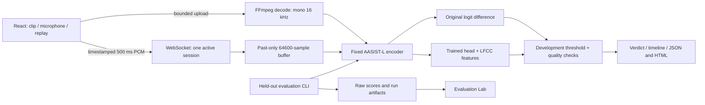

# VoiceGuard architecture

The server loads one model instance, uses inference/eval mode and serializes CPU work. HTTP upload and streaming share a semaphore. WebSocket packets contain a 32-bit sequence, 64-bit start-sample timestamp and 8000 little-endian float32 samples. Invalid size, order, timestamps or nonfinite PCM closes the session. Uvicorn queues at most two packets; the client allows one in-flight packet and two queued chunks, then stops with an overload message.

The unchanged encoder can execute through a checksum-verified ONNX CPU graph (four threads, spinning disabled), while the adaptation head remains PyTorch. Encoder and complete-head parity are verified against the original PyTorch model. PyTorch eager/TorchScript remains available as fallback. Small LFCC matrix operations use one BLAS thread to avoid competing thread pools.

The AudioWorklet downmixes channels, uses a causal FIR low-pass filter and incremental phase resampling at actual browser sample rates. Replay obtains decoded PCM only, then sends it through the same transport on wall-clock 500 ms intervals. No full-recording score enters live inference. A short final replay packet is zero-padded and the padding duration is disclosed.

FFmpeg has bounded output duration, a decoding timeout, protocol and demuxer allowlists, fixed subprocess arguments and automatic temporary-directory cleanup. Uploaded recordings are not retained. There is no history database by default; exports are explicitly downloaded by the user. Metadata/scoring artifacts for public evaluation data remain on disk. Existing OneDrive settings are outside this application's control.

Large assets, archive parts, feature caches and the native environment use `D:/VoiceGuardData` or `VOICEGUARD_DATA`. App code, small weights, frontend build and reports remain in the project. Docker maps the data directory read-only and binds the public port to localhost only. Browser APIs cannot automatically intercept normal cellular calls.
