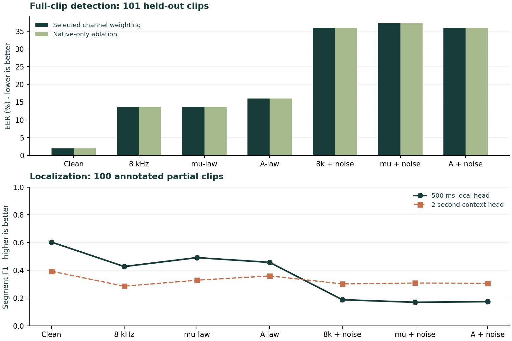

# CallGuard - measured submission report

Local CPU speech-authenticity prototype for English, Hindi and Tamil. Prepared 24 October 2026.

**Clean EER: 2.00%. Worst degraded EER: 37.25%.**
The 2.5x clean-EER target is **NOT MET**. These results come from a small exploratory subset; speaker and generator holdouts cannot be verified.

**Streaming:** 500 ms updates; 34.5 ms p95 local round-trip latency; maximum offline/stream score difference 0.00000.

## Data and selection

720 public labeled clips, 120 per class per language. Normalized text groups determine the train/development/test split. The official challenge test partition was not used because its labels are unavailable.

| Language | Train | Development | Test |
|---|---:|---:|---:|
| English | 168 | 42 | 30 |
| Hindi | 177 | 20 | 43 |
| Tamil | 175 | 37 | 28 |

Selected classifier: **extra-trees**. Channel weights: `{'native': 1.0, 'mulaw': 0.0, 'alaw': 0.0}`. Both window heads use separate development-selected thresholds.

The initial test run exposed weak phone/noise robustness. Its report is retained as `initial-evaluation.json`. The bounded follow-up model/weight selection used development data and a clean-EER guardrail; its complete record is in `robust-selection.json`.

## Measured results

| Condition | EER (%) | Native EER (%) | Local F1 | Long F1 | Accepted (%) | p95 ms/bin |
|---|---|---|---|---|---|---|
| clean | 2.00 | 2.00 | 0.604 | 0.394 | 60.2 | 38.5 |
| resample8k | 13.73 | 13.73 | 0.427 | 0.286 | 74.6 | 43.9 |
| mulaw | 13.73 | 13.73 | 0.492 | 0.329 | 60.2 | 50.3 |
| alaw | 16.00 | 16.00 | 0.457 | 0.360 | 61.7 | 39.8 |
| resample8k_noise10 | 36.00 | 36.00 | 0.188 | 0.302 | 99.0 | 48.4 |
| mulaw_noise10 | 37.25 | 37.25 | 0.170 | 0.309 | 98.5 | 53.5 |
| alaw_noise10 | 36.00 | 36.00 | 0.174 | 0.307 | 98.0 | 28.2 |



EER uses all full-clip scores. Acceptance coverage includes full and partial clips. Localization uses all partial-clip bins; bins ending before 2 seconds receive a negative prediction during warm-up. The selected native-only weighting makes its EER identical to the native-only ablation; codec probes still contribute uncertainty flags.

## Requirement status

- Phone-channel degradation target: NOT MET; worst/clean ratio 18.63x.
- 100 partial clips: generated, with timestamp labels and source hashes; 34 English, 33 Hindi, 33 Tamil.
- Same-speaker partials: unverified. Speaker changes and splice artifacts can confound localization.
- 500 ms streaming: verified with a timed local replay. Physical microphone/cellular capture were not verified.
- Unseen synthesis-tool generalization: unverified because the dataset lacks tool identities.
- Original Phase 1 retention: not assessable; no original model/results/test protocol was supplied.

## Reproduce

```powershell
python tools/fetch_public_subset.py --per-class 120
python -m callguard.cli train data/indictts/manifest.jsonl --exploratory --classifier linear --output models/baseline-linear.json
python -m callguard.cli train data/indictts/manifest.jsonl --exploratory --classifier extra-trees --output models/candidate-trees.json
python -m callguard.cli train data/indictts/manifest.jsonl --exploratory --classifier rbf-svm --output models/candidate-svm.json
python tools/robust_select.py data/indictts/manifest.jsonl models/baseline-linear.json models/candidate-trees.json models/candidate-svm.json
python -m callguard.cli partials data/indictts/manifest.jsonl --count 100 --exploratory
python -m callguard.cli evaluate data/indictts/manifest.jsonl --partials data/partials/manifest.jsonl
```

## Evidence and credits

Model SHA-256: `6757f9475ce35373a14354c7a3bd58ebfd1218b721381218a6b732dffe528c77`.

Data: [SherryT997 / IndicTTS Deepfake Detection Challenge](https://huggingface.co/datasets/SherryT997/IndicTTS-Deepfake-Challenge-Data), CC BY 4.0, revision `57347517658ae989597d8cef303cffb647ed2434`. Changes include subsampling, duration filtering/cropping, telephone transforms and annotated splicing.

Prior work: [ASVspoof 2021](https://github.com/asvspoof-challenge/2021), [compression-aware detection](https://arxiv.org/abs/2501.05545), and [partial speech localization](https://arxiv.org/abs/2605.29531). The project makes no world-first novelty claim.

A score is neither a calibrated fraud probability nor proof of the caller's identity. Real-world validation remains necessary.